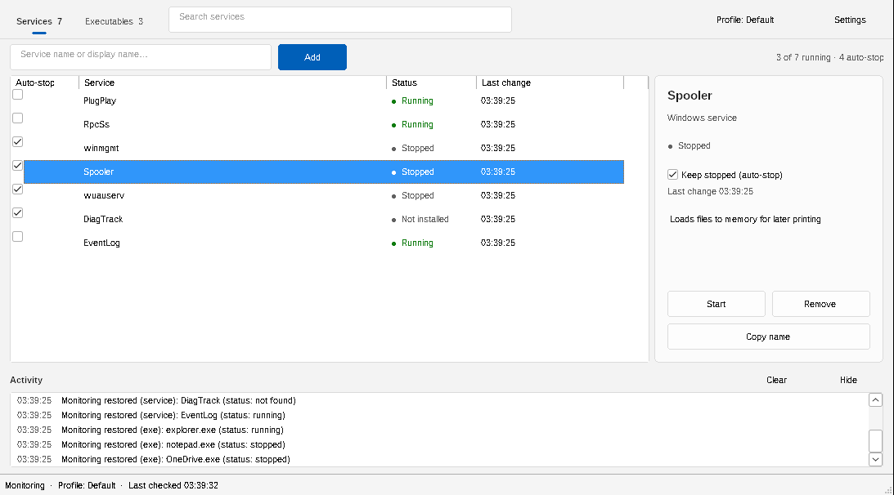

# ServicesMonitorExe

A lightweight Windows desktop app that **keeps chosen Windows services and executables stopped** — and switches behavior automatically based on which programs you're running.

It's a single native `.exe` (no installer, no runtime dependencies) with a single plain-text `.cfg` file created next to it.

---

## What it's for

Some background services and helper executables start themselves repeatedly — on boot, on update, or whenever a parent app launches — even when you don't want them running. ServicesMonitorExe watches a list you define and, for any item with **Auto-Stop** enabled, stops it again whenever it comes back, on a configurable interval.

**Profiles** take this further: a profile activates automatically when a *watched program* is running, swapping in a different set of items and settings, and optionally launching companion apps/files. When the watched program exits, you drop back to your default set. For example:

- *"While `game.exe` is running, stop these telemetry/updater services and launch Discord; otherwise leave them alone."*
- *"Keep `SomeUpdater.exe` and a vendor service stopped at all times, but pause enforcement for 15s after each stop so I'm not fighting a service that legitimately restarts."*

---

## Features

**Monitoring & enforcement**
- Monitors both **Windows services** (via the Service Control Manager) and **executables** (by process name).
- Per-item **Auto-Stop** toggle — when on, a running item is stopped again on the next monitor tick.
- **Cooldown** between repeated stop attempts, and **error backoff** that temporarily suspends Auto-Stop for a service that keeps refusing to stop (prevents tight retry loops).
- Manual **Start / Stop / Remove** actions for any item.
- Executables are terminated via process handles, with a `taskkill /F` fallback.

**Profiles**
- Named configuration snapshots that **auto-activate** when any of their *watched* `.exe` names is detected running (first match wins; falls back to **Default** when none match).
- Each profile carries its own item list, Auto-Stop flags, and timing settings.
- **Start Items**: files, apps, shortcuts, folders, or URLs to shell-open when the profile activates; processes the app launched are closed again when the profile deactivates.

**Interface**
- Windows 11-style (Fluent) look in light and dark mode: flat rounded controls, icon glyphs (Segoe Fluent Icons / Segoe MDL2 Assets), accent-colored primary actions.
- One header row: **Services** / **Executables** tabs with item counts, a search box, the active **Profile** (click to manage profiles) and a **Settings** menu.
- Add row: type a name and press **Enter** (or click **Add**); **Browse…** on the Executables tab. A live summary shows how many items are running / set to auto-stop.
- Sortable, column-persistent lists (Auto-stop, Name, Status, Path, Last change). Status reads *Running*, *Stopped*, *Not installed*, *Starting…* with a colored dot; a running item that's set to auto-stop is highlighted.
- **Detail card** for the selected item: live status, a **Keep stopped (auto-stop)** toggle, how many times it was stopped automatically, the service description, and Start/Stop, Remove, Copy name and Open location actions.
- **Activity log** with timestamps and highlighted errors / auto-stop events; Clear and Hide buttons.
- **System tray** support with minimize-to-tray and close-to-tray.
- **Per-monitor DPI** awareness; window placement, panel sizes, column widths/order, active tab and theme are persisted.



---

## Requirements

- **Windows 10 or 11** (x64).
- **Administrator privileges.** Stopping most Windows services requires elevation, so the app relaunches itself elevated (UAC) at startup.

---

## Usage

1. Launch `ServicesExeMonitor.exe` (accept the UAC prompt).
2. On the **Services** or **Executables** tab, type a service key name or an executable name (e.g. `wuauserv` or `notepad.exe`) and add it. For executables you can also **Browse…** to a file.
3. Tick **Auto-Stop** on the items you want kept stopped.
4. (Optional) Open **Profiles** to define watched programs, per-profile item sets, and Start Items.
5. Tune timing in **Preferences** (all values in milliseconds):
   - **Check every** — how often statuses are polled / enforcement runs (default `1000`, min `200`). Services are additionally watched with Windows service notifications, so a service that restarts is stopped again immediately rather than on the next poll.
   - **Re-stop cooldown** — minimum gap between repeated stop attempts on the same item (default `15000`).
   - **Stop/start timeout** — how long to wait for a stop/terminate to complete (default `10000`).
   - **Refresh UI every** — fallback repaint interval for the window.

Settings and your item/profile lists are saved to **`windows_service_monitor.cfg`** next to the executable.

### Keyboard shortcuts

| Shortcut | Action |
|----------|--------|
| `Ctrl+F` | Focus the search box |
| `Ctrl+1` | Switch to the Services tab |
| `Ctrl+2` | Switch to the Executables tab |
| `Ctrl+L` | Focus the main list |
| `Ctrl+S` | Save configuration now |
| `Ctrl+D` | Toggle dark mode |
| `Ctrl+G` | Toggle the activity log pane |
| `F5`     | Refresh the view |
| `Enter`  | Add the item typed in the add box |
| `Space`  | Toggle auto-stop for the selected row |
| `Delete` | Remove the selected row |
| `Ctrl+C` | Copy the selected item's name |
| `Esc`    | Clear the search box |

---

## Building

The project builds with the **MinGW-w64 GCC** toolchain (C++20). The easiest setup is [MSYS2](https://www.msys2.org/) using the **UCRT64** environment:

```bash
pacman -S mingw-w64-ucrt-x86_64-gcc make
```

Then, from the repository root:

```bash
make
```

This compiles the sources in `src/`, builds the resource object from `app.rc` (icon + manifest) with `windres`, and links **`ServicesExeMonitor.exe`** into the repository root. Useful targets:

```bash
make syntax   # compile-only check (no link)
make clean    # remove build output
```

The build is fully static (`-static`), so the resulting `.exe` has no external runtime dependencies.

Cross-compiling from Linux also works (e.g. Ubuntu's `g++-mingw-w64-x86-64`):

```bash
make CXX=x86_64-w64-mingw32-g++-posix WINDRES=x86_64-w64-mingw32-windres
```

---

## Project layout

```
src/
  main.cpp         Entry point, window procedure & message handlers, accelerators
  monitor.cpp      Monitor thread: status polling + Auto-Stop enforcement
  action.cpp       Action worker thread: start/stop/terminate operations
  config.cpp       Config + profile load/save (atomic, versioned)
  profiles.cpp     Profile activation / watched-exe matching
  ui_layout.cpp    Window layout, splitters, resizing
  ui_listview.cpp  List views, rows, filtering
  ui_dialogs.cpp   Preferences / Profiles / Hotkeys / Diagnostics dialogs
  theme.cpp        Theme palette & control theming
  darkmode.cpp     Dark-mode plumbing
  tray.cpp         System tray icon
  app.cpp          App-wide helpers
  util.cpp/.h      Small shared utilities
  app.h            Core data model & shared declarations
app.rc / app.ico / app.manifest   Resources
Makefile           Build
```

### How it works (brief)

- A **monitor thread** wakes on the monitor interval, takes a single process snapshot per tick (skipped entirely when there's nothing to watch), queries service states, decides which Auto-Stop items need enforcing, and posts UI updates. It also registers for service status-change notifications (`NotifyServiceStatusChangeW`) and waits alertably, so service changes wake it immediately.
- An **action thread** performs the actual start/stop/terminate work off the UI thread, so the interface stays responsive.
- The **UI** is event-driven: only rows whose status actually changed are repainted.
- Configuration saves are **atomic** (temp file → fsync → rename) and carry a version marker.

---

## License

Licensed under the **GNU Affero General Public License v3.0** — see [LICENSE](LICENSE).
